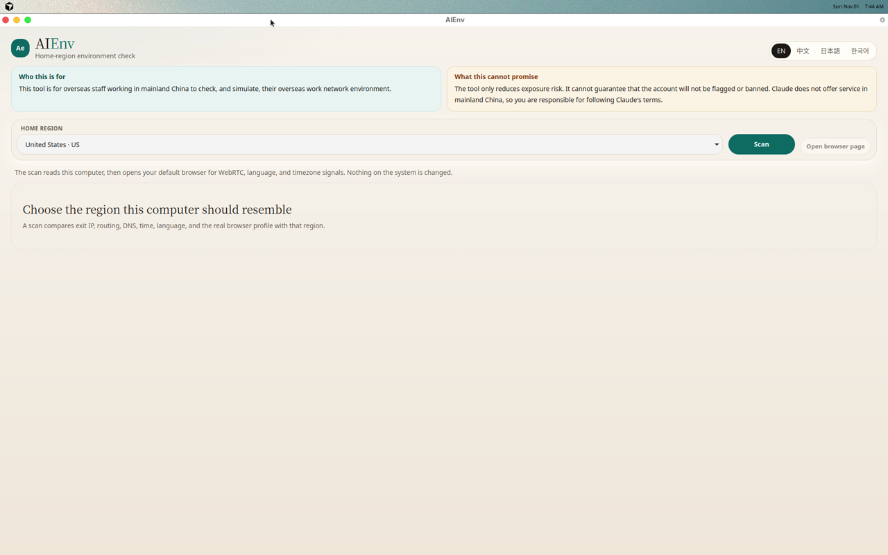
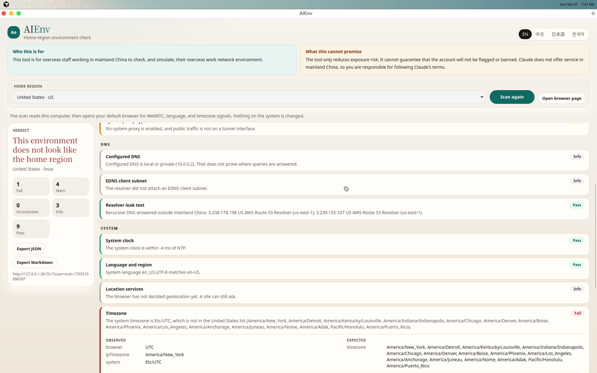
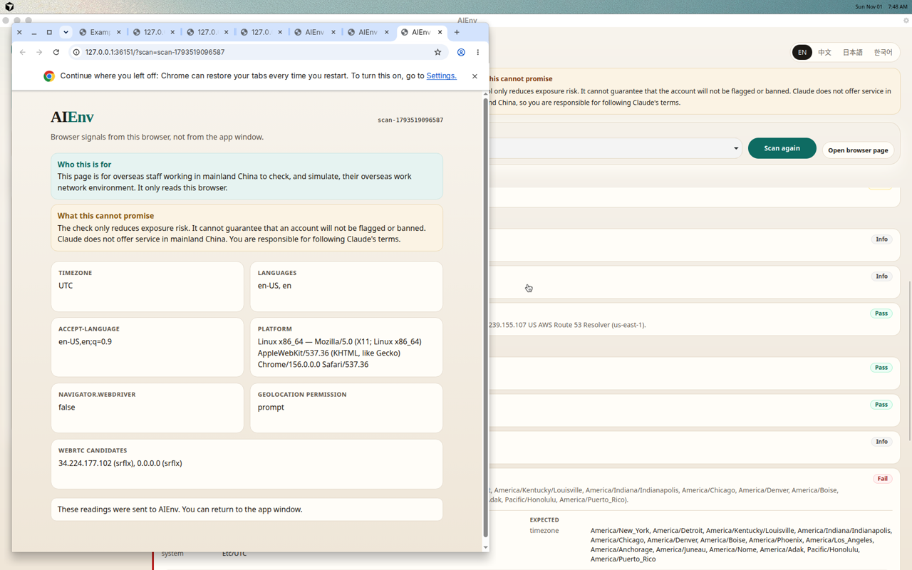

# AIEnv

AIEnv is a desktop check for overseas staff who are physically in mainland China and want their computer to resemble a normal work environment in a home region where Claude is offered. It compares exit IP, routing, DNS, time, language, and the real browser profile with a region preset.

Scans are read-only. Confirmed repairs now use transactional backups and rollback; hosts cleanup is the first supported repair. See [repair transactions](docs/transactions.md) for the framework, helper boundary, and validation limits.

## Notices

These two notices are always on the main screen:

1. This tool is for overseas staff working in mainland China to check, and simulate, their overseas work network environment.
2. The tool only reduces exposure risk. It cannot guarantee that the account will not be flagged or banned. Claude does not offer service in mainland China, so you are responsible for following Claude's terms.

## What a scan checks

Each item returns a status (`pass`, `warn`, `fail`, `info`, or `inconclusive`), the observed values, the expected values, an explanation, and advice.

- IPv4 and IPv6 exit country and city, plus a cheap hosting/datacenter hint
- Whether public IPv4 goes through a tunnel interface
- Whether the system proxy bypass list or PAC lets Claude or Anthropic through
- Configured DNS, a resolver leak test, and the EDNS client subnet
- IPv6 leaving via a physical interface
- UDP/QUIC exposure, inferred from the routing table
- WebRTC, browser timezone, languages, Accept-Language, and fingerprint consistency, collected in the default browser
- System timezone, locale, location services, and clock offset versus NTP
- `hosts` entries for Claude and Anthropic, and the TLS issuer for `claude.ai`
- Reachability and latency for `claude.ai` and `api.anthropic.com`

Region presets cover common Claude-supported homes: the United States (several timezones), Canada, the United Kingdom, a set of European countries, Japan, Singapore, South Korea, Taiwan, Australia, and New Zealand. Mainland China, Hong Kong, and Macao are not presets.

The default UI language is English. zh-CN, Japanese, and Korean are included.

Reports export as JSON and Markdown into the downloads folder, or the home folder if downloads are unavailable.

## Build and run

Requirements: Rust 1.90 or newer, Node.js 20 or newer, and the Tauri 2 system packages for your OS.

```bash
npm install
npm test          # Rust unit tests
npm run tauri dev # run the app
npm run tauri build -- --bundles none  # release binary without an installer
```

### Linux

Install the Tauri 2 WebKitGTK dependencies, then use the commands above. On Ubuntu 24.04 that includes `libwebkit2gtk-4.1-dev`, `libgtk-3-dev`, `libayatana-appindicator3-dev`, `librsvg2-dev`, `patchelf`, and a C toolchain. Route lookup uses `ip` when it is on `PATH` or in `/usr/sbin`, and otherwise reads `/proc/net/route`.

This repository was built, unit-tested, and run on Ubuntu Linux. A real scan was executed there. Screenshots from that run:







### macOS

Install Xcode command line tools and Rust, then `npm install` and `npm run tauri dev`. Collectors call `scutil`, `route`, and `defaults`. Those parsers are unit-tested against sample output. They were not executed on a Mac in this phase, and reading the Location Services preference may require a local user privilege the app does not have.

### Windows

Install the [WebView2](https://developer.microsoft.com/microsoft-edge/webview2/) runtime, Rust, and Node.js, then `npm install` and `npm run tauri dev`. Collectors call PowerShell (`Find-NetRoute`, `Get-DnsClientServerAddress`, `Get-TimeZone`, `Get-Culture`) and the Internet Settings registry. Windows timezone ids are mapped to IANA names for the presets. None of this was executed on Windows in this phase.

## Architecture

```text
React UI  --invoke-->  Tauri commands
                           |
                           v
                     ScanContext
                     /    |     \
            EnvironmentCheck   Platform snapshot     NetworkDirectory
            detect             linux | macos |       PublicDirectory today
                               windows               (ipinfo, ip-api, bash.ws,
                                                       Google o-o.myaddr TXT)
                           |
                           v
              127.0.0.1 HTTP page in the default browser
              WebRTC, Intl timezone, languages, Accept-Language
```

- One read-only `EnvironmentCheck` trait per item. Separate typed repair plans run through the transaction service and privileged `SystemAdapter` boundary.
- OS-specific collection is behind `cfg`. Shared parsers are tested without a Mac or Windows machine.
- IP geolocation, DNS leak, and EDNS client subnet sit behind `NetworkDirectory`, so a self-hosted directory can replace the public services later.
- Browser signals are not read from the Tauri WebView. Its fingerprint is not the user's browser. The app serves a page on `127.0.0.1` only and opens it in the default browser.

## Phase 1 limits

- Scans change no system settings. Confirmed hosts cleanup can change the hosts file; proxy, DNS, registry, and timezone repairs are not enabled.
- UDP/QUIC is a routing inference, not a live QUIC handshake.
- A PAC script is only text-searched for Claude and Anthropic names.
- Datacenter detection uses ip-api's hosting flag when present, plus organization-name keywords. It is a hint, not a registry lookup.
- Public lookup services can rate-limit or block a network. A missing result is inconclusive, not a pass.
- macOS and Windows collectors compile with the rest of the crate only on those targets. They were not run as part of this Linux verification.

---

# AIEnv（中文）

AIEnv 是给在中国大陆工作的海外员工用的桌面检查工具。它对照家乡地区预设，看这台电脑的出口 IP、路由、DNS、时间、语言，以及真实浏览器画像，是否像那个地区的正常办公环境。

第一阶段只检测、出报告，不修改系统。备份、恢复和修复留在检查接口里，作为第二阶段的空实现。

## 两条说明

这两条说明一直显示在主界面上，不放在设置里：

1. 这个工具供在中国大陆工作的海外员工使用，用来检查并模拟其海外办公网络环境。
2. 本工具只降低暴露风险，不能保证账号不会被标记或封禁。Claude 不在中国大陆提供服务，你需要自行遵守 Claude 的条款。

## 扫描内容

每一项都返回状态（通过、留意、未通过、信息、无法判定）、实际值、期望值、说明和建议。

- IPv4 / IPv6 出口的国家和城市，以及能低成本看出的机房或托管 ASN
- 公网 IPv4 是否走隧道网卡
- 系统代理的绕过名单或 PAC 是否放行 Claude / Anthropic
- 系统 DNS、实际解析器泄漏测试、EDNS 客户端网段
- IPv6 是否从物理网卡漏出去
- UDP / QUIC 是否直连（根据路由表推断）
- 在系统默认浏览器里收集的 WebRTC、浏览器时区、语言、Accept-Language 和指纹是否一致
- 系统时区、区域语言、定位服务，以及相对 NTP 的时钟偏差
- hosts 里有没有 Claude / Anthropic，以及 claude.ai 的 TLS 证书颁发者
- claude.ai 和 api.anthropic.com 的可达性与延迟

地区预设只包含 Claude 支持的常见家乡地区：美国（多个时区）、加拿大、英国、若干欧洲国家、日本、新加坡、韩国、台湾、澳大利亚、新西兰。不包含中国大陆、香港和澳门。

界面默认英文，并带有简体中文、日文和韩文。

报告可以导出为 JSON 和 Markdown，写到下载目录；没有下载目录时写到用户主目录。

## 构建和运行

需要 Rust 1.90 或更新版本、Node.js 20 或更新版本，以及本机的 Tauri 2 系统依赖。

```bash
npm install
npm test          # Rust 单元测试
npm run tauri dev # 运行
npm run tauri build -- --bundles none  # 只编发布版可执行文件，不打安装包
```

### Linux

先安装 Tauri 2 的 WebKitGTK 依赖，再执行上面的命令。Ubuntu 24.04 上包括 `libwebkit2gtk-4.1-dev`、`libgtk-3-dev`、`libayatana-appindicator3-dev`、`librsvg2-dev`、`patchelf` 和 C 工具链。路由优先用 `ip`（`PATH` 或 `/usr/sbin`），没有就读 `/proc/net/route`。

本仓库在 Ubuntu Linux 上完成了编译、单元测试和实际运行，并做了一次真实扫描。截图见上方英文部分，文件在 `docs/screenshots/`。

### macOS

安装 Xcode 命令行工具和 Rust 后，执行 `npm install` 和 `npm run tauri dev`。采集调用 `scutil`、`route` 和 `defaults`。解析器用样例输出做了单元测试，但这一阶段没有在 Mac 上实际跑过。读取定位服务偏好可能需要应用没有的本机用户权限。

### Windows

安装 [WebView2](https://developer.microsoft.com/microsoft-edge/webview2/) 运行时、Rust 和 Node.js 后，执行 `npm install` 和 `npm run tauri dev`。采集调用 PowerShell（`Find-NetRoute`、`Get-DnsClientServerAddress`、`Get-TimeZone`、`Get-Culture`）和 Internet Settings 注册表。Windows 时区 ID 会映射成预设里的 IANA 名称。这一阶段没有在 Windows 上实际跑过。

## 架构

界面是 React。Tauri 命令调用 Rust 扫描。每个检查项实现同一个 `EnvironmentCheck`：`detect`、`fix`、`backup`、`restore`。现在只有 `detect`。另外三个返回“尚未实现”，不能当成修复。

Linux、macOS、Windows 的采集各自在 `cfg` 后面。IP 地理、DNS 泄漏和 EDNS 客户端网段放在 `NetworkDirectory` 后面。当前实现使用 ipinfo.io、ip-api.com、bash.ws，以及 Google 的 `o-o.myaddr` TXT。以后可以换成自建服务，而不用改检查项。

浏览器信号不从 Tauri 窗口读。那个窗口的指纹和用户的浏览器不一样。应用只在 `127.0.0.1` 上开一个页面，并用系统默认浏览器打开。

## 第一阶段的边界

- 不改代理、不改 hosts、不改时区。
- UDP/QUIC 只根据路由表推断，没有做真实 QUIC 握手。
- PAC 只做文本搜索，看里面有没有 Claude 或 Anthropic。
- 机房判断用 ip-api 的 hosting 字段（如果有）和组织名关键词，不是注册库查询。
- 公共查询服务可能限流或被网络拦住。没有结果是“无法判定”，不是通过。
- macOS 和 Windows 的采集代码只在对应系统上参与编译。这次的 Linux 验证没有运行它们。
